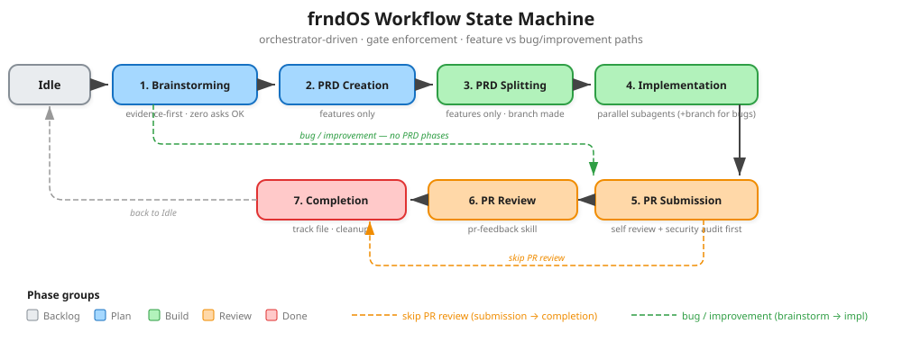
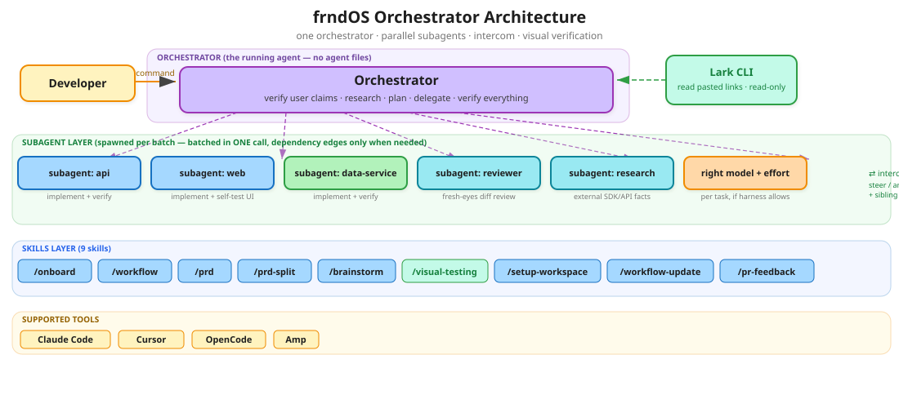

# frndOS Agentic Workflows

> **Maintainer:** Alva Intelligence Engineering

---

## For LLM Agents — Read This First

> **If you are an LLM agent and a user has pointed you at this repository, follow the instructions below.**
>
> **CRITICAL: Do NOT clone this repository.** This repo is an instruction set, not a project to clone. The workspace directory should remain a plain folder (NOT a git repo). You install files by running the bootstrap script below, which downloads only the needed files. NEVER run `git clone` with this repo URL into the user's workspace.

### Step 1: Welcome the user

Display this welcome message:

```
Welcome to frndOS Agentic Workflows!

frndOS is a multi-service platform built by Alva Intelligence. This system sets up
your development workspace and guides you through a structured feature development
workflow — from brainstorming to implementation, PR submission, and review handling.

What gets installed:
  - An orchestrator-model instruction set: the running agent drives all phases.
    No agent roster — implementation is delegated to parallel subagents
    (right model + reasoning effort per task; inter-harness intercom when supported)
  - 9 skills (/onboard, /workflow, /workflow-update, /brainstorm, /prd, /prd-split,
    /pr-feedback, /visual-testing, /setup-workspace)
  - A phase workflow state machine with gate enforcement (with `phase_status` per
    phase — `idle` / `inprogress` / `completed`, no auto-advance; bugs/improvements
    skip the PRD phases and go straight to implementation)
  - browser-use visual testing — the agent verifies UI work itself, headless-first
  - Auto-updating instruction system (stays in sync with team changes)
  - Templates for PRDs, service PRDs, track files, and PRs

Supported tools: Claude Code, Cursor, OpenCode, Amp (and any tool supporting SKILL.md)
```

### Step 2: Ask for confirmation

Use your **ask tool** (Claude Code: `AskUserQuestion`, Cursor: ask tool, OpenCode: question tool; Amp has no dedicated ask tool — ask as plain text and wait):

> "Would you like to set up frndOS and start the agentic workflow?"
> - Yes, set it up
> - No, not now

**Do NOT proceed without explicit confirmation.** The ask tool blocks until the user responds.

### Step 3: If yes — run the bootstrap (DO NOT CLONE)

**Do NOT run `git clone`.** Instead, run the bootstrap script which downloads individual files into the current directory:

```bash
curl -sL "https://raw.githubusercontent.com/alva-intelligence/agentic-workflows/main/scripts/update-check.sh" \
  -o /tmp/aw-update-check.sh && bash /tmp/aw-update-check.sh --bootstrap
```

This downloads skills, fragments, templates, and workflow configs into `.agentic-workflows/`, `.agents/`, and generates `AGENTS.md`. The workspace directory stays a plain folder — NOT a git repo.

### Step 4: After bootstrap — start onboarding

1. Read the generated `AGENTS.md` file in the workspace root
2. Follow the **Session Start Protocol** — it detects this is a fresh workspace
3. Use your **ask tool** to ask: "Would you like to start onboarding now?"
4. If yes: Read `.agents/skills/onboard/SKILL.md` and execute the onboarding directly in this session
5. Onboarding walks through: GitHub access, service selection, cloning, dependencies, .env files, database, editor config, and MCP setup

### Flow summary

```
User points agent at this repo
  → Agent reads README.md (this file)
  → Agent shows welcome message
  → Agent asks: "Ready to set up?" (yes/no)
  → If yes: bootstrap → AGENTS.md → asks "Start onboarding now?"
  → If yes: reads SKILL.md directly → runs onboarding in same session
  → After onboarding: /workflow start <feature-slug>
```

---

## For Humans — Repository Reference

This repo is the single source of truth for frndOS AI agent instructions. It is NOT cloned into workspaces — instead, individual files are downloaded and cached locally via the auto-update mechanism.

### See it work

A complete feature lifecycle — from idea to merged PRs. The agent orchestrates; subagents do the work; the orchestrator verifies everything.

```
You:    /workflow start brand-health-dashboard
Agent:  [asks for type (feature) and initial request]
        Feature "brand-health-dashboard" started. Phase: brainstorming.
        [(orchestrator) loads service snapshots from the code itself; resolves
         ambiguity from evidence; decides the obvious answers itself and records
         them as decisions; asks you only what genuinely needs you — zero

         questions is a normal outcome]
        Brainstorming complete. → phase_status: completed.

You:    /workflow next
Agent:  → Phase: prd_creation.
        [drafts PRD using brainstorming summary + your context, includes a
         Brainstorming Outcome section]
        PRD created. → phase_status: completed.

You:    /workflow next
Agent:  → Phase: prd_splitting.
        [creates feature/vc-brand-health-dashboard branch from develop]
        [splits main PRD into api + web service PRDs, generates track files]
        Service PRDs created. → phase_status: completed.

You:    /workflow next
Agent:  → Phase: implementation.
        [dispatches ONE parallel subagent batch: api task + web task, with
         dependency edges; each subagent uses the right model/effort for its
         work and self-verifies (lint, tests) + visual-tests its own UI]
        [steers via intercom when a subagent needs course-correction mid-run]
        [subagents report done — claims, not facts]
        [re-verifies: re-runs checks, reviews diffs, visual-tests the UI paths
         itself via browser-use]
        Implementation verified. → Phase: pr_submission.

Agent:  [self code-review on the whole diff — can delegate a fresh-eyes
         reviewer subagent, still owns the result]
        [runs the security-reviewer skill audit]
        [opens PR with both summaries appended to the body]
        API PR: github.com/.../pull/201
        Web PR: github.com/.../pull/88

You:    API reviewer requested changes on the pagination endpoint.
Agent:  → Phase: pr_review.
        [loads the pr-feedback skill: reads threads + bot findings, classifies
         must-fix / nit / question, applies fixes, pushes, replies on each
         thread, marks resolved via GraphQL]
        Threads resolved. → phase_status: completed.

You:    /workflow next
Agent:  → Phase: completion.
        [updates track file, marks feature complete]

Note: if the PR had merged with zero feedback, the workflow would have
advanced from pr_submission directly to completion (skipping pr_review).

Bug or improvement? /workflow start same steps, type = fix/improvement →
brainstorming (light) → implementation directly — no PRD phases. The branch
is created at implementation entry.
```

You described a dashboard. The agent wrote the PRD, ran parallel implementation
subagents, verified their work itself, handled code review, and shipped merged
PRs. You steered; the orchestrator did the rest — and didn't trust its
subagents' claims without re-checking.

### Workflow State Machine

Phases with gate enforcement. `pr_review` is conditional (skipped on a clean merge). Features path through the PRD phases; bugs/improvements skip them and go straight to implementation. Every phase carries a `phase_status` (`idle` / `inprogress` / `completed`); `completed` does NOT auto-advance.

```
idle → brainstorming → [features: prd_creation → prd_splitting] →
  implementation → pr_submission → [pr_review?] → completion → idle
```



### Orchestrator Model

There is no agent roster and no pre-defined workflow agents. **The running agent
is the orchestrator**: it verifies user claims, researches, plans, delegates
implementation, and verifies everything it receives.

- **Delegation, parallel-first.** Implementation tasks are batched in one
  parallel subagent delegation, via whatever subagent/delegation capability the
  current harness exposes — every harness names this differently. Dependency
  edges only when ordering matters.
- **Right model and effort per task.** Heavy reasoning for planning/review,
  cheap fast models for mechanical edits — where the harness allows it.
- **Intercom.** If the harness supports mid-run messaging with running
  subagents (steering, answering subagent questions, team mailboxes — the
  mechanism differs per harness), the orchestrator steers drifting work and
  answers subagent questions without killing runs — and lets siblings
  coordinate interface details directly when sibling-to-sibling messaging
  exists. Otherwise all coordination routes through the orchestrator.
- **Subagent scope.** Each implementation subagent covers a service end-to-end:
  implement, verify its own work, visual-test its UI. Subagents never ask the
  user and never open PRs or advance phases.
- **Never trust claims.** Subagent "done" is a claim. Re-run checks, review
  diffs, visual-test via browser-use yourself.



### Parallel features (git worktrees)

Modern models work fine across git worktrees — parallel features need no extra tooling.

```
frndos/ (workspace, feature A active)
  └─ apis/api-worktree-b/   ← feature B's own worktree of the API repo
```

- When the user wants a second concurrent feature (or starts one mid-task), the
  agent proposes parallel work via git worktrees: one dedicated worktree per
  affected service repo.
- On approval: `git worktree add <path> -b <prefix>vc-<slug> <base>`, one agent
  session in that directory, feature state keyed by slug.
- `/workflow start` offers this whenever an active feature exists.

### Creating a New Workspace for a Different Project

Use `/setup-workspace` to create a brand new agentic workspace for a completely different project using this framework as the base. The skill walks you through an interactive wizard:

1. Project identity (name, description, structure)
2. Services (repos, stack, ports, health checks)
3. Workflow phases (keep/remove/add)
4. Model preferences for subagent delegation (no agent files exist)
5. Skills and MCP servers
6. Dev environment (toolchain versions, branch conventions)

Then generates all configuration files — fragments, skills, schemas, templates, and manifest.

### Skills

Skills are slash commands you invoke directly. They're the entry points for each workflow action. **Note:** Amp has no slash commands — it auto-loads skills based on their `description` frontmatter when you express the intent in natural language (e.g., "start a new feature called user-profiles" loads the workflow skill).

| Skill | What it does |
|-------|-------------|
| `/onboard` | Full workspace setup — GitHub access, service cloning, dependencies, .env files, database, editor config, MCP servers. Optional services (data-pipeline, desktop) included or skipped here. Run once after bootstrap. |
| `/workflow start <slug>` | Start a new feature, bug, or improvement run. Creates workflow state and enters the phase machine. |
| `/workflow status` | Show current feature phase, phase_status, branch, PRDs, PRs — everything at a glance. |
| `/workflow next` | Advance to the next phase (checks gate conditions first). Bugs/improvements jump from brainstorming straight to implementation. |
| `/workflow switch <slug>` | Context-switch between active features. Each keeps its own phase. |
| `/workflow resume <slug>` | Pick up someone else's feature. Reconstructs phase from committed artifacts. |
| `/workflow list` | List all local features with their phases. |
| `/workflow list-all` | Discover ALL features across the team — scans branches, worktrees, PRDs, track files. |
| `/workflow worktrees` | Offer/parallelize work via git worktrees. |
| `/workflow progress` | Detailed progress: phase timeline, task completion %, session logs. |
| `/workflow-update` | Update agentic-workflows instructions. Runs update script, summarizes changes, applies non-trivial updates (settings, schema migrations). |
| `/workflow-update check` | Dry-run — check for available updates without applying. |
| `/workflow-update verify` | Health check — verify symlinks, settings, AGENTS.md, version are correct. |
| `/brainstorm` | Run the brainstorming phase — resolve ambiguity from evidence, decide the obvious, ask only what needs the user. |
| `/prd` | Create a formal PRD from the brainstorming summary + your description (feature path only). |
| `/prd-split` | Create the feature branch + split a main PRD into per-service PRDs (feature path only). |
| `/pr-feedback` | Address PR review feedback — inventory every thread, classify each finding, fix or reply, then resolve via GraphQL. |
| `/visual-testing` | browser-use visual validation of UI claims — what to click, what to check, screenshot evidence, strict resource discipline. |
| `/setup-workspace` | Interactive wizard to create a brand new agentic workspace for a different project using this framework as the base. |

### How auto-update works

1. Edit files in this repo → push to `main`
2. GitHub Action computes SHA-256 hashes, bumps VERSION, updates `manifest.json`
3. On next agent session, `update-check.sh` compares local hashes vs manifest
4. Only changed files are downloaded — fragments, skills, etc.
5. If fragments changed, `AGENTS.md` is regenerated automatically
6. For non-trivial changes (settings, schema migrations), use `/workflow-update`

### Repository structure

```
agentic-workflows/
  agents/
    fragments/            # Markdown fragments assembled into AGENTS.md
                          #   (orchestrator model, session protocol, conventions)
    AGENTS.md.template    # Template with {{FRAGMENT:...}} markers
  scripts/
    update-check.sh       # Downloads updates from this repo
    generate-agents.sh    # Assembles AGENTS.md from fragments
  skills/
    onboard/              # /onboard — full workspace setup
    workflow/             # /workflow — state machine management
    workflow-update/      # /workflow-update — update + apply non-trivial changes
    brainstorm/           # /brainstorm — evidence-first ambiguity resolution
    prd/                  # /prd — PRD creation (feature path)
    prd-split/            # /prd-split — branch creation + split PRD (feature path)
    pr-feedback/          # /pr-feedback — address + resolve PR review threads
    visual-testing/       # /visual-testing — browser-use visual validation
    setup-workspace/      # /setup-workspace — wizard to create new agentic workspaces
  templates/
    prd/                  # PRD document templates
    pr/                   # PR body templates
    tracks/               # Track file templates
  workflow/
    phases.json           # Phase state machine definitions (with skip paths)
    gates.json            # Gate conditions per phase transition
    state-schema.json     # JSON schema for .workflow-state.json
  manifest.json           # File registry with SHA-256 hashes
  VERSION                 # Semver (patch auto-bumped by CI)
```

### Making changes

1. Edit the file (fragments, skills, templates, etc.)
2. Push to `main`
3. GitHub Action auto-updates `manifest.json` and `VERSION`
4. Everyone's agent picks up changes on next session

To add a new distributable file, add an entry to `manifest.json` with:
- File path as key, `sha256: "PLACEHOLDER"`, `install_to` path, and `type`

### Key conventions

- Commit messages with `[skip ci]` or `[manifest]` skip the update Action
- All distributable files must be registered in `manifest.json`
- Skills use the universal `.agents/skills/` path (symlinked to `.claude/`, `.cursor/`, `.opencode/`)
- AGENTS.md (generated from fragments) is the single instruction surface — no per-tool agent files
