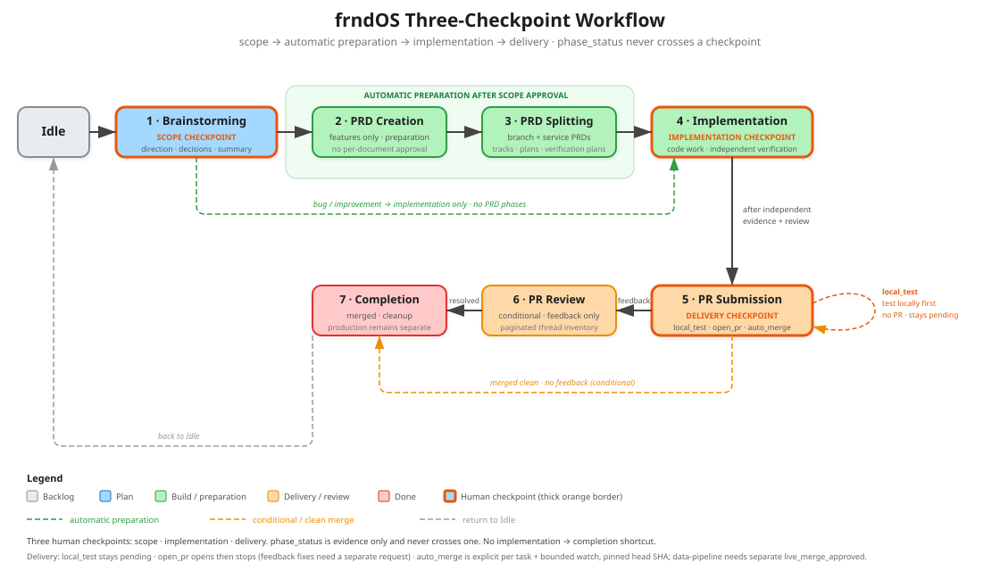
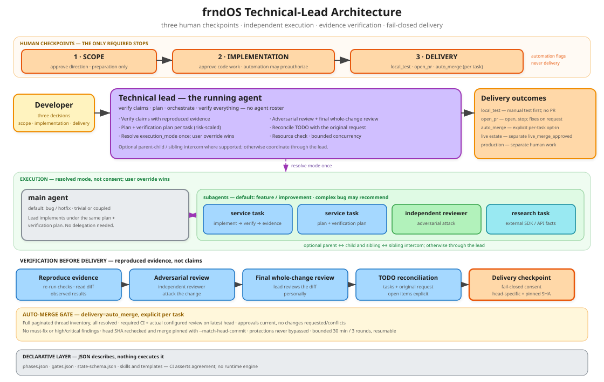

# frndOS Agentic Workflows

> **Maintainer:** Alva Intelligence Engineering

---

## For LLM Agents — Read This First

> **If you are an LLM agent and a user has pointed you at this repository, follow the instructions below.**
>
> **CRITICAL: Do NOT clone this repository.** This repo is an instruction set, not a project to clone. The workspace directory should remain a plain folder (NOT a git repo). You install files by running the bootstrap script below, which downloads only the needed files. NEVER run `git clone` with this repo URL into the user's workspace.

### Step 1: Welcome the user

Display this welcome message:

```
Welcome to frndOS Agentic Workflows!

frndOS is a multi-service platform built by Alva Intelligence. This system sets up
your development workspace and guides you through a three-checkpoint workflow —
scope, implementation, and delivery — with automatic preparation between the
scope and implementation checkpoints.

What gets installed:
  - An orchestrator-model instruction set: the running agent is the technical lead.
    Implementation is delegated to independent subagents when useful, with the
    right model and reasoning effort per task and optional parent-child or
    sibling messaging where the environment supports it.
  - 9 skills (/onboard, /workflow, /workflow-update, /brainstorm, /prd,
    /prd-split, /pr-feedback, /visual-testing, /setup-workspace)
  - A three-checkpoint workflow state machine: scope → automatic preparation →
    implementation → delivery. Bugs and improvements skip comprehensive PRDs.
  - Visual testing of UI work — the agent reproduces rendering claims itself.
  - Auto-updating instructions and curated model recommendations (stays in sync with team changes)
  - Templates for PRDs, service PRDs, track files, and PRs

Supported: any agent environment that loads SKILL.md skills and can delegate work.
Capability differences (delegation, messaging, model selection) degrade gracefully.
```

### Step 2: Ask for confirmation

Use your environment's question capability if it has one; otherwise ask in plain text and wait:

> "Would you like to set up frndOS and start the agentic workflow?"
> - Yes, set it up
> - No, not now

**Do NOT proceed without explicit confirmation.** If your environment has a blocking ask capability, use it so the run pauses for the answer.

### Step 3: If yes — run the bootstrap (DO NOT CLONE)

**Do NOT run `git clone`.** Instead, run the bootstrap script which downloads individual files into the current directory:

```bash
curl -sL "https://raw.githubusercontent.com/alva-intelligence/agentic-workflows/main/scripts/update-check.sh" \
  -o /tmp/aw-update-check.sh && bash /tmp/aw-update-check.sh --bootstrap
```

This downloads skills, fragments, templates, and workflow configs into `.agentic-workflows/`, `.agents/`, and generates `AGENTS.md`. The workspace directory stays a plain folder — NOT a git repo.

### Step 4: After bootstrap — start onboarding

1. Read the generated `AGENTS.md` file in the workspace root
2. Follow the **Session Start Protocol** — it detects this is a fresh workspace
3. Ask: "Would you like to start onboarding now?"
4. If yes: read `.agents/skills/onboard/SKILL.md` and execute onboarding directly in this session
5. Onboarding walks through: GitHub access, service selection, cloning, dependencies, .env files, database, editor config, and MCP setup

### Flow summary

```
User points agent at this repo
  → Agent reads README.md (this file)
  → Agent shows welcome message
  → Agent asks: "Ready to set up?" (yes/no)
  → If yes: bootstrap → AGENTS.md → asks "Start onboarding now?"
  → If yes: reads SKILL.md directly → runs onboarding in same session
  → After onboarding: /workflow start <feature-slug>
```

---

## For Humans — Repository Reference

This repo is the single source of truth for frndOS AI agent instructions. It is NOT cloned into workspaces — instead, individual files are downloaded and cached locally via the auto-update mechanism.

### See it work

A complete feature lifecycle — from idea to merged PRs. The agent leads; independent subagents execute when useful; the lead verifies everything and stops at three human checkpoints.

```
You:    /workflow start brand-health-dashboard
Agent:  [captures type (feature) and request, enters scope]
        [loads real service state, decides what evidence can decide, asks only
         what genuinely needs you, records decisions with rationale]
        Scope checkpoint: direction + summary + decisions.
        Approve this scope? [yes]
        → scope_approved (authorizes preparation only, never code)

Agent:  [automatic preparation — no per-document approval, no /workflow next]
        main PRD → feature branch created locally → service PRDs → track files
        with per-task plans and verification plans. The branch is not pushed yet:
        push waits for delivery (open_pr / auto_merge) or an explicit push request.
        Implementation checkpoint: one package with scope summary, branch,
        services, tracks, plans, risks, and resolved execution mode
        (feature/improvement default: independent subagents).
        Approve implementation? [yes]
        → implementation_approved (authorizes code changes)

Agent:  [implements; delegates independent work; lead re-runs checks, reviews
         diffs, visual-tests UI, runs adversarial review, personally reviews
         the whole change, reconciles TODO against the original request]
        Delivery checkpoint: local_test, open_pr, or auto_merge? [open_pr]

Agent:  [self-review + security audit, opens PR, stops before merge]
        API PR: github.com/.../pull/201
        Web PR: github.com/.../pull/88

You:    API reviewer requested changes on the pagination endpoint.
        Please address them.
Agent:  [records the separate feedback request, then loads the pr-feedback skill:
         paginates every thread, classifies must-fix / nit / question, fixes
         what is valid, replies, resolves only addressed threads]
        Threads resolved.

You:    I merged both PRs.
Agent:  [verifies both PRs actually report MERGED, records the human merge]
        → completion → idle.

Note: auto_merge is a separate per-task opt-in. The agent opens, monitors,
fixes, and merges only under the full fail-closed conditions below, within a
bounded watch (default 30 minutes / 3 fix rounds). It rechecks the latest head
SHA immediately before merging and pins the merge with
--match-head-commit <reviewed-sha>. data-pipeline needs a separate live-estate
approval; production promotion stays separate human work.

Bug or improvement? type = bug/improvement/hotfix → scope checkpoint →
implementation checkpoint directly — no PRD phases. The branch and task plans
are created on implementation entry. Hotfix work is stored as type bug; there
is no separate hotfix type.
```

### Workflow State Machine

Three human checkpoints. Everything between scope and implementation is automatic preparation; everything after delivery is execution plus verification. `pr_review` is conditional (skipped on a clean merge).

```
idle → brainstorming [SCOPE] → [features: prd_creation → prd_splitting] →
  implementation [IMPLEMENTATION] → pr_submission [DELIVERY] →
  [pr_review?] → completion → idle

features:         brainstorming → prd_creation → prd_splitting → implementation
                  (prd_creation/prd_splitting advance automatically after scope)
bug/improvement:  brainstorming → implementation
                  (branch + plans prepared at implementation entry)
```

- `phase_status` (`idle` / `inprogress` / `completed`) records phase work only. `completed` does NOT authorize crossing any checkpoint, opening a PR, merging, or skipping a gate.
- No implementation → completion shortcut. `implementation` only advances to `pr_submission`; completion is reachable only through the delivery checkpoint (and `pr_review` when there is feedback).
- `local_test` keeps the delivery checkpoint pending. The feature does not complete until the user finishes manual testing and then chooses `open_pr` or `auto_merge`.



### Three human checkpoints

Only three moments need a person. Every other step is automatic preparation or verified execution.

| Checkpoint | Where | Authority | What it authorizes |
|---|---|---|---|
| **Scope** | end of `brainstorming` | `scope_approved: true` | Preparation only: PRDs, branch, tracks, plans. Never code changes. |
| **Implementation** | between preparation and the first code change | `implementation_approved: true` or `automation.implementation: true` | Writing, changing, or deleting project code. |
| **Delivery** | after independent verification, at `pr_submission` | `delivery: "local_test" \| "open_pr" \| "auto_merge"`; `live_merge_approved: true` separately for a live estate | What happens to the verified work. |

**Independent authority.** Scope approval, implementation auto-start, and merge consent are separate:

- `scope_approved` never authorizes code changes.
- Reaching `implementation` with a prepared branch and plans is not implementation approval.
- `delivery: "auto_merge"` never authorizes a live-estate merge.
- Missing authorization fails closed: no PR, no merge, no publication.
- Branch creation is local. A push waits for `delivery: open_pr` / `auto_merge`, or a separate explicit user instruction to push; scope and implementation approval alone never authorize a push.
- Do not re-ask a checkpoint the user already approved or preauthorized. Record it once and continue.

**Opt-in automation.** Automation is per-feature, user-granted, and conservative:

| Flag | Default | Effect |
|---|---|---|
| `automation.brainstorming` | `false` | The agent may record recommended/chosen directions and set `scope_approved` without a second ask. Destructive, taste-based, or expensive-to-reverse decisions still stop for the user. |
| `automation.implementation` | `false` | Implementation entry is preauthorized after preparation, with no second ask. Independent of scope approval. |

`automation` has no delivery or merge powers. It never opens a PR, merges, changes a live estate, or promotes to production. Do not invent other flags; record any other standing permission in the track and the relevant `verification` entry.

**Execution defaults.** `execution_mode` is resolved before implementation starts and is not a consent flag:

| Work | Default |
|---|---|
| `feature` | independent subagents |
| `improvement` | independent subagents |
| `bug` (including hotfix) | main agent |
| trivial or tightly coupled task | main agent, any type, with rationale recorded |
| complex bug | may recommend subagents; never switch silently |
| user override | wins, recorded, not asked again |

### State contract and migration

The checkpoint fields are optional per-feature state. Every default is safe when the field is absent:

```json
{
  "scope_approved": false,
  "automation": { "brainstorming": false, "implementation": false },
  "execution_mode": null,
  "implementation_approved": false,
  "delivery": null,
  "live_merge_approved": false
}
```

| Field | Values | Default | Set by |
|---|---|---|---|
| `scope_approved` | boolean | `false` | Scope checkpoint (explicit agreement, recorded skip, or `automation.brainstorming`) |
| `automation.brainstorming` | boolean | `false` | Explicit user instruction |
| `automation.implementation` | boolean | `false` | Explicit user instruction |
| `execution_mode` | `"main"` \| `"subagents"` \| `null` | `null` | Resolved before implementation; user override wins |
| `implementation_approved` | boolean | `false` | Implementation checkpoint or `automation.implementation` |
| `delivery` | `"local_test"` \| `"open_pr"` \| `"auto_merge"` \| `null` | `null` | Explicit user instruction only, per feature/task |
| `live_merge_approved` | boolean | `false` | Separate explicit user approval for this task |

A user-requested brainstorming skip counts as **scope approval only**. It never authorizes implementation, delivery, or a push.

**Migration rules**

- Existing `.workflow-state.json` files without these fields remain valid. Read an absent field as its safe default; do not rewrite state just to add fields.
- A feature copied from an older workspace has no recorded checkpoint authority. Re-confirm the pending checkpoint before crossing it.
- A feature reconstructed from branch/PRD/track/PR artifacts never inherits scope, implementation, delivery, or live-merge consent. Reset the checkpoint fields to their safe defaults and re-confirm.
- Verified, explicitly persisted consent for the **same task** may survive resume. Never infer consent from artifacts, copy it from another task, carry it across a new scope/target, or treat a global default as consent.
- `phase_status: "completed"` is evidence that the phase's artifacts/checks are satisfied. It does not cross a checkpoint, and preparation phases do not need `/workflow next`.

### Delivery and auto-merge

Delivery is chosen once at the checkpoint, after independent verification. `delivery: null` fails closed: no PR, no merge, no live publication.

| Delivery | Result |
|---|---|
| `local_test` | The user manually tests the verified work locally first. No PR is opened, the branch/worktree/server stays available, and `pr_submission` stays pending. The feature never completes from a local test: after the user reports the result, they choose `open_pr` or `auto_merge` (or test again). |
| `open_pr` | Self-review and security audit, then open the PR(s) and stop before any merge. Address feedback only on a separate explicit request; merging is a human action. |
| `auto_merge` | Explicit per-task consent to open, monitor, fix, and merge under the full auto-merge gate below. |

**Auto-merge gate** — every condition must hold on the current head:

1. **Authority.** `delivery` is explicitly `auto_merge` for this task; `implementation_approved` is true; `live_merge_approved` is true for a live estate. Missing any authorization means no merge.
2. **Full feedback inventory.** Paginate every review-thread page and every PR-level comment/review. Every thread is resolved; resolve only threads actually addressed. Historical addressed comments do not count as open feedback. Zero threads before the configured expected review arrives is not completion.
3. **Required checks and review on the latest head.** All required CI checks pass on the latest commit. The review the repository actually requires (required approvals, CODEOWNERS, bot review) has completed on that same head.
4. **Approvals current.** No changes requested, required approvals present for the latest head, no merge conflicts, and every branch protection satisfied.
5. **Proof package clean.** Self-review, security audit, adversarial review, and the final whole-change review are recorded with no must-fix items and no high/critical findings.
6. **Head-specific proof.** Every push invalidates prior head-specific proof. Re-read the latest head SHA and re-run the merge-critical checks immediately before merging; record the SHA and pin the merge command with `--match-head-commit <reviewed-sha>`.
7. **No bypass.** Never bypass branch protections, admin-merge, force-push a shared branch, or disable/skip a required check.
8. **Native mechanisms.** Prefer a native auto-merge or merge queue only when it enforces these same conditions. Otherwise wait for checks and merge normally.

**Bounded watch.** Default 30 minutes and 3 fix rounds, unless the user overrides one. Progress, deadline, rounds, and last checked head SHA live in the track; a timeout or session end pauses the watch as resumable. There is no background daemon; never claim background monitoring or completion.

**Live estates.** `data-pipeline` is live even on `development` — a merge is running work. `delivery: "auto_merge"` alone is insufficient: require a separate explicit approval for that task and record `live_merge_approved: true`. Production promotion remains separate human work; no workflow path performs or bypasses it.

### Technical lead contract

The running agent is the technical lead. It owns planning, verification, and the final verdict. Subagents execute delegated units; their "done" is a claim, not a fact.

- **Plan + verification plan for every task, scaled to risk.** Before implementation, each task gets a short plan (approach, touched areas, dependencies, risks) and a verification plan (expected evidence, exact checks, risk level).
- **Evidence, not claims.** Re-run checks, read the diff against the task, and reproduce behavior yourself. Record commands and observed results. Never describe checks or tests as "formal verification" or "formal proof".
- **Independent subagents when useful.** Delegate independent work in one batch, use dependency edges only when ordering matters, and steer through optional parent-child or sibling messaging when the environment supports it. Otherwise coordinate through the lead.
- **Adversarial review and final whole-change review.** Use an independent reviewer (a fresh subagent or a separate pass) to attack the change, then personally review the whole diff end to end before delivery.
- **Resources.** Before intensive work (browser automation, builds, migrations, data jobs), check disk, memory, and CPU headroom. Bound concurrency. Release only resources the task owns (processes, ports, tabs, temp files); never kill shared infrastructure.
- **TODO reconciliation.** Update the task checklist after each completed task. Before the final report, reconcile the checklist and the original request: every requested item accounted for, nothing extra silently added.

**Verification policy.** No dependency is added for testing, and no new test infrastructure is scaffolded by default. Existing targeted tests, lint, type checks, build checks, and manual reproduction are the default evidence. For non-trivial logic, leave one small runnable regression check; reuse an existing check where sufficient. A trivial one-line change needs none. New suites, frameworks, or test dependencies are not part of default verification. Never run an entire suite when a targeted check answers the question.



### Parallel features (git worktrees)

Modern models work fine across git worktrees — parallel features need no extra tooling.

```
frndos/ (workspace, feature A active)
  └─ apis/api-worktree-b/   ← feature B's own worktree of the API repo
```

- When the user wants a second concurrent feature (or starts one mid-task), the
  agent proposes parallel work via git worktrees: one dedicated worktree per
  affected service repo.
- On approval: `git worktree add <path> -b <prefix>vc-<slug> <base>`, one agent
  session in that directory, feature state keyed by slug.
- `/workflow start` offers this whenever an active feature exists.

### Collaboration service

`alva-intelligence/frnd-hocuspocus` runs in `hocuspocus/` on default port **1234**
(`npm run dev`, Node **20.12+**, `GET /health`). Its development/PR base is **`main`**; use
feature branches and the normal delivery checkpoint, never direct main pushes or implicit deploys.

It is frndOS's shared Yjs state service for **Decks, Docs, KV canvases and Studio graphs**, plus
presence in **Proposals, Insights and Market**. The API owns authentication/permissions and database
migrations; Hocuspocus persists updates in that same Postgres and exposes internal HTTP document
operations to the API. Studio run/version facts also flow through this bridge.

Onboarding includes it by default when web/full-stack is selected; unrelated setups may skip it.
Before collaboration work, verify the service plus `NEXT_PUBLIC_HOCUSPOCUS_URL` (web), `COLLAB_URL`
(API), `API_BASE_URL` (including `/api`), `DATABASE_URL` and matching internal tokens (Hocuspocus/API).
Keep secrets out of logs and reports. Existing customized env/start/launch files are never silently
rewritten by an instruction update; rerun the relevant onboarding steps with consent.

A page loading is not a persistence check: Studio and Decks have local-only fallback paths when
collaboration is unconfigured. Verify two authorized clients exchanging edits and a reload after
saving when testing real collaboration. This framework change does not patch app fallback behavior
or establish that any live deployment is misconfigured.

### Model recommendations

[`workflow/model-catalog.json`](workflow/model-catalog.json) is the single curated catalog of main
and subagent model/effort pairs, with one strongly recommended choice per role and alternatives.
Recommended means strongly recommended, not required. Update the catalog rather than duplicating
model names in instructions or editor configuration.

Use the user's actually available configured models and supported effort, regardless of provider
or subscription. Resolve real identifiers through the environment; labels are not API IDs. Keep
explicit user choices, do not silently switch the main model or add providers, and explain a usable
fallback if the preferred pair is unavailable.

The normal updater distributes catalog changes. On onboarding, session start and immediately after
an update, the agent reviews a new/changed catalog, summarizes recommendations and availability,
then records its digest in `.agentic-workflows/.model-catalog-reviewed`. An unchanged completed
review does not repeat the notice; an interrupted review is not acknowledged. No background model
discovery or ranking service is added.

### Creating a New Workspace for a Different Project

Use `/setup-workspace` to create a brand new agentic workspace for a completely different project using this framework as the base. The skill walks you through an interactive wizard:

1. Project identity (name, description, structure)
2. Services (repos, stack, ports, health checks)
3. Workflow phases (keep/remove/add)
4. Advisory model catalog and environment-supported delegation (no agent files exist)
5. Skills and MCP servers
6. Dev environment (toolchain versions, branch conventions)

Then generates all configuration files — fragments, skills, schemas, templates, and manifest.

### Skills

Skills are slash commands you invoke directly. They're the entry points for each workflow action. Some environments auto-load a skill based on its `description` when you express the intent in natural language instead of typing the slash command.

| Skill | What it does |
|-------|-------------|
| `/onboard` | Full workspace setup — GitHub access, service cloning, dependencies, .env files, database, editor config, MCP servers. Includes Hocuspocus by default for web/full-stack; data-pipeline and desktop are optional. Run once after bootstrap. |
| `/workflow start <slug>` | Start a feature, bug, or improvement run. Creates workflow state and enters the scope checkpoint. |
| `/workflow status` | Show current phase, phase_status, checkpoints, branch, PRDs, tracks, PRs, and review watch. |
| `/workflow next` | Optional explicit, gate-checked transition. Not required for automatic preparation and cannot substitute for a checkpoint approval. |
| `/workflow switch <slug>` | Context-switch between active features. Each keeps its own phase and checkpoint state. |
| `/workflow resume <slug>` | Pick up someone else's feature. Reconstructs artifacts/phase; checkpoint authority is not inherited. |
| `/workflow list` | List all local features with their phases. |
| `/workflow list-all` | Discover ALL features across the team — scans branches, worktrees, PRDs, track files. |
| `/workflow worktrees` | Offer/parallelize work via git worktrees. |
| `/workflow progress` | Detailed progress: phase timeline, checkpoint table, task completion, plans/evidence, review watch. |
| `/workflow-update` | Update agentic-workflows instructions. Runs update script, summarizes changes, applies non-trivial updates (settings, schema migrations). |
| `/workflow-update check` | Dry-run — check for available updates without applying. |
| `/workflow-update verify` | Health check — verify symlinks, settings, AGENTS.md, version are correct. |
| `/brainstorm` | Run the scope checkpoint — resolve ambiguity from evidence, decide the obvious, ask only what needs the user. |
| `/prd` | Automatic preparation: create the main PRD from the approved scope (feature path only). |
| `/prd-split` | Automatic preparation: create the feature branch locally + split the main PRD into per-service PRDs and tracks (feature path only). |
| `/pr-feedback` | Address PR review feedback — full paginated thread inventory, classify each finding, fix or reply, resolve only addressed threads. |
| `/visual-testing` | Visual validation of UI claims — what to click, what to check, screenshot evidence, strict resource discipline. |
| `/setup-workspace` | Interactive wizard to create a brand new agentic workspace for a different project using this framework as the base. |

### How auto-update works

1. Edit files in this repo → push to `main`
2. GitHub Action computes SHA-256 hashes, bumps VERSION, updates `manifest.json`
3. On next agent session, `update-check.sh` compares local hashes vs manifest
4. Only changed files are downloaded — fragments, skills, etc.
5. Files removed upstream are pruned automatically: every update cycle persists
   a manifest snapshot, diffs it against the next release's keys, and deletes
   installed files whose manifest entries vanished
6. If fragments changed, `AGENTS.md` is regenerated automatically
7. A new/changed model catalog triggers a review and user notice; explicit choices remain intact
8. For non-trivial changes (settings, schema migrations, one-time legacy
   cleanup predating the snapshot), use `/workflow-update`

### Repository structure

```
agentic-workflows/
  agents/
    fragments/            # Markdown fragments assembled into AGENTS.md
                          #   (orchestrator model, session protocol, conventions)
    AGENTS.md.template    # Template with {{FRAGMENT:...}} markers
  docs/
    workflow-state-machine.svg  # Three-checkpoint phase machine
    agent-architecture.svg      # Technical-lead + execution + delivery architecture
    DECISIONS-LEDGER.md         # Direction-change history and open questions
  scripts/
    update-check.sh       # Downloads updates from this repo
    generate-agents.sh    # Assembles AGENTS.md from fragments
    check-manifest-coverage.py  # Every distributed file is declared (CI)
    check-workflow.py     # Workflow metadata + generator version regression (CI)
  skills/
    onboard/              # /onboard — full workspace setup
    workflow/             # /workflow — state machine management
    workflow-update/      # /workflow-update — update + apply non-trivial changes
    brainstorm/           # /brainstorm — evidence-first scope checkpoint
    prd/                  # /prd — automatic main PRD preparation
    prd-split/            # /prd-split — branch + service split preparation
    pr-feedback/          # /pr-feedback — address + resolve PR review threads
    visual-testing/       # /visual-testing — visual validation of UI work
    setup-workspace/      # /setup-workspace — wizard to create new agentic workspaces
  templates/
    prd/                  # PRD document templates
    pr/                   # PR body templates
    tracks/               # Track file templates
  workflow/
    phases.json           # Phase state machine definitions (checkpoints + auto paths)
    gates.json            # Gate conditions, checkpoint rules, delivery policy
    state-schema.json     # JSON schema for .workflow-state.json (optional consent fields)
    model-catalog.json    # Curated main/subagent recommendations; no provider pins
  .github/workflows/
    check-manifest-coverage.yml  # CI: manifest coverage + workflow metadata
    update-manifest.yml          # CI: rehash distributed files on main
  manifest.json           # File registry with SHA-256 hashes
  VERSION                 # Semver (patch auto-bumped by CI)
```

### Making changes

1. Edit the file (fragments, skills, templates, etc.)
2. Push to `main`
3. GitHub Action auto-updates `manifest.json` and `VERSION`
4. Everyone's agent picks up changes on next session

To add a new distributable file, add an entry to `manifest.json` with:
- File path as key, `sha256: "PLACEHOLDER"`, `install_to` path, and `type`

Repo-internal checks (`scripts/check-workflow.py`, `scripts/check-manifest-coverage.py`) are deliberately excluded from `manifest.json`: they validate this repository's own declarative files in CI and are not part of an onboarded workspace's runtime.

### Key conventions

- Commit messages with `[skip ci]` or `[manifest]` skip the update Action
- All distributable files must be registered in `manifest.json`
- Skills use the universal `.agents/skills/` path (symlinked to `.claude/`, `.cursor/`, `.opencode/`)
- AGENTS.md (generated from fragments) is the single instruction surface — no per-tool agent files
- Workflow metadata is declarative JSON; no runtime engine executes it. CI asserts that phases, gates, schema references, checkpoint fields, and the generator version handling agree
- Checkpoint authority is explicit per feature/task; absent consent fields default safe and never inherit across tasks
